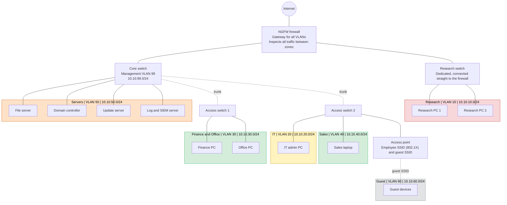

# Network Security Proposal for a Growing Company

Course project in **Network Security**, IT Security Technician programme (TUC Yrkeshögskola, 2026).
The company in the scenario is fictional.

## Background

A company started by two founders has grown fast and now has products that competitors are interested in. The whole business runs on one flat network behind a consumer router, the most important documents are stored on a single desktop PC and the Wi-Fi uses one shared key. The company expects to keep growing and asked for a proposal covering six areas: research, IT administration, finance and office, sales, a local file server and wireless access.

The proposal was written for the company's decision makers, so the original focuses on functions and plain language rather than specific brands.

## Summary

The network is split into zones based on how sensitive each part of the business is. All traffic between zones has to pass a next generation firewall (NGFW), and the starting point is **default deny**: nothing is allowed until the business actually needs it.

- **Research** gets the highest protection level, in its own zone with no internet access.
- **Documents** move to a file server in a protected zone, with backup and access controlled per department.
- **Sales laptops** are protected on the device itself, since they are used outside the office.
- **Wi-Fi** stays, but every employee signs in with their own identity instead of a shared key, and guests are fully separated.

The design is built to grow. New departments and more employees fit into the existing equipment without redesigning anything. Not everything has to be done at once: replacing the router and segmenting the network, followed by moving the documents to a server with backup, gives the biggest effect.

## Current state and risks

| Today | Risk |
|---|---|
| One flat network | Every device can reach every other device. Malware on one PC can spread to everything, and an attacker who gets in anywhere can reach research as easily as reception. |
| Consumer router | Lets traffic through without inspecting it. No intrusion prevention, no web filtering, no logs to look at afterwards, security updates for only a few years and no support. |
| Documents on one desktop PC | No backup, so a disk failure, theft or ransomware means the data is gone. No access control and no record of who opened, changed or copied a file. |
| One shared Wi-Fi key | The key ends up on every device and often with visitors. Removing one person's access means changing the key on every device, which rarely happens. The signal also reaches the parking lot. |

In short: one compromised PC gives access to the whole company, the most important information has no protection and no copy, and there is no way to see what happens in the network or who did what.

## Design principle

Instead of one network, each department gets its own zone. A firewall sits between the zones and decides what is allowed through. This gives three things the company does not have today:

1. **Containment.** Malware on a finance PC stays in the finance zone, because the firewall does not let that traffic through to research or the servers.
2. **Depth.** An attacker who gets into one zone still has to get past the firewall to reach the next one.
3. **Visibility.** All traffic between zones passes the same point, so it can be logged and investigated afterwards.

The separation is done logically with **VLANs**, so two computers can sit on the same switch and still be in separate networks. This keeps cost down, and a new department later just means a new zone in the existing equipment.

The exception is research, which gets its own switch connected straight to the firewall. That zone is separated physically as well as logically, so a misconfigured port in another department can never give access to it.

## Network diagram

Modelled in Cisco Packet Tracer, where an ASA 5506-X stands in for the NGFW. Colours show protection level: red highest, orange high, yellow administrative, green normal and grey untrusted.

## Zones and addressing

| Zone | VLAN | Subnet | Protection level | Notes |
|---|---|---|---|---|
| Research | 10 | 10.10.10.0/24 | Highest | No internet. Own physical switch connected straight to the firewall. |
| IT | 20 | 10.10.20.0/24 | Administrative | The only zone allowed to reach the management network. |
| Finance and Office | 30 | 10.10.30.0/24 | Normal | Internet through the firewall's filters. |
| Sales | 40 | 10.10.40.0/24 | Normal | Internet through the firewall's filters. Remote access over VPN. |
| Servers | 50 | 10.10.50.0/24 | High | File server, domain controller, update server, log server. No direct internet access. |
| Guest | 60 | 10.10.60.0/24 | Untrusted | Internet only. |
| Management | 99 | 10.10.99.0/24 | Administrative | Firewall, switches and access points are managed from here. |

## Traffic between zones

Anything not listed below is denied, and all traffic between zones is logged. The table shows who may **start** a connection; return traffic is handled by the stateful firewall.

| From \ To | Research | Servers | Management | Other user zones | Internet |
|---|---|---|---|---|---|
| **Research** | | Update server and a few approved internal servers | Deny | Deny | Deny (a single external address can be opened when needed) |
| **IT** | Deny | Administration from the admin workstation | Admin workstation only, encrypted protocols, MFA | Deny | Filtered, never from the admin workstation |
| **Finance and Office** | Deny | Own department folders and shared folder | Deny | Deny | Allowed through web filter and IPS |
| **Sales (office)** | Deny | Own department folders and shared folder | Deny | Deny | Allowed through web filter and IPS |
| **Sales (remote, VPN)** | Deny | Only what the role needs | Deny | Deny | n/a |
| **Guest** | Deny | Deny | Deny | Deny | Allowed, no traffic between guest devices |
| **Servers** | Deny | | Deny | Deny | Update server only |

Wireless users end up in the same zone as if they were plugged in with a cable, so the same rules apply to them.

## Proposal per area

### 1. Research

The brief says the research computers *barely* need internet. That means the need is small but not zero, which decides what the right solution is.

Fully disconnecting them sounds safest but works badly in practice. A computer that never reaches the network gets no security updates and becomes less secure over time, and staff still need to move files, so USB sticks become the only way. The risk moves instead of disappearing.

Instead, research gets its own zone with no internet access, where the computers can only reach a few internal servers. An internal update server downloads updates from the internet and the research computers fetch them from that server, so they stay patched without ever talking to the internet directly. If a specific external service is needed now and then, only that address is opened.

On top of the segmentation:

- **Dedicated switch** connected straight to the firewall, so the zone is separated both logically and physically.
- **No Wi-Fi coverage** in the zone, since the signal goes through walls and outside the building.
- **USB storage blocked**, as it is a way in for malware and a way out for data.
- **Application allowlisting**, so only approved programs can run, even if malware lands on a machine.
- **Locked room and disabled unused network ports**, so physical access to the premises is not enough.

This makes daily work a bit less convenient, which is justified. An infected office PC can be reinstalled, but research that has reached a competitor cannot be taken back.

### 2. IT and access to network equipment

Whoever can log in to the firewall, switches and access points can also turn off every other protection in this design, so this access needs to be tightly controlled.

- **Separate management network** (VLAN 99), reachable only from the IT zone. Never from other departments and never from the internet.
- **Personal admin accounts** instead of a shared password, so every change can be traced to a person and one person's access can be removed.
- **Multi-factor authentication** for all administrative logins.
- **Central logging** of every login and every change.
- **Encrypted management protocols only** (for example SSH and HTTPS). Old unencrypted protocols such as Telnet and HTTP are turned off.

IT staff should also have two accounts, one for everyday work and one for administration, and ideally a dedicated admin workstation. If a technician reads email and browses on the same machine they manage the firewall from, one wrong click can hand an attacker the whole network.

Finally, there should be a routine for when someone leaves or changes roles. Accounts left behind after people leave are one of the most common causes of unauthorized access, and the problem grows with every new hire.

### 3. Finance and office

This zone has lower requirements than research but still needs solid protection. This is where email is opened, invoices are handled and websites are visited, and it is usually where breaches start. The design therefore assumes this zone will be hit sooner or later.

The zone has internet access, but through an NGFW that can inspect the traffic, block known malicious sites, stop malicious files and detect intrusion attempts. That is the key difference from today's router, which lets everything through without judging the content.

- **Web filtering and IPS** in the firewall.
- **Email filtering**, since email is the most common way in for both malware and fraud.
- **EDR** on the computers, which reacts to suspicious behaviour and not just known viruses, and alerts IT.
- **No local admin rights** for regular users, so malware cannot install itself freely.
- **Multi-factor authentication** at login, so a stolen password is not enough.
- **Patch routine** for operating systems and applications.

The zone cannot reach research or the network equipment, and towards the servers only the folders the staff work in are opened.

**A note on encrypted traffic.** Almost all web traffic is encrypted today, so the firewall sees which site is visited but not what is sent. Getting the full effect of the web filter requires the firewall to decrypt that traffic (TLS inspection). It works well technically, but it means the company can see the content of employees' traffic. If used, it should be covered by a policy the staff know about, both for privacy reasons and because GDPR sets strict requirements on handling employee data.

### 4. Sales

Sales laptops are used both in the office and on the road. In the office they sit in their own zone like everyone else, but the moment they leave the building that protection is gone. They connect to hotel, café and customer networks that the company neither controls nor can trust. The protection therefore has to live on the laptop itself.

- **Full disk encryption**, so a lost or stolen laptop cannot be read. Without it, removing the drive is enough to get to everything on it.
- **EDR**, which works the same regardless of which network the laptop is on.
- **VPN** for reaching company resources, so nobody on the local network can listen in.
- **Certificate and MFA for the VPN**, since a tunnel is only secure if you know who is at the other end.
- **Central device management** (for example Intune), so IT can check that laptops are patched and wipe one remotely if it goes missing.
- **Restricted VPN access**, so salespeople only reach what they need. Nobody should be able to reach research from a hotel room.

### 5. File server

The company wants a local server instead of cloud storage to keep control over where the data is. That is a reasonable choice, but it also means the responsibility for protecting it lies entirely with the company.

The file server sits in the server zone without direct internet access and is connected to the company's directory (Active Directory). Access is based on which department a person belongs to, not on separate accounts on the server. A new hire in finance automatically gets the right folders, and when someone leaves, disabling the account removes their access everywhere.

Folders are split per department (finance, sales, research) plus one shared folder, and each person only sees what they need for their own work.

- **Group based permissions**, not per user, so access stays manageable as the company grows.
- **Encrypted storage**, so data cannot be read if a disk is stolen or sent away for repair.
- **Encrypted transfer** between computers and the server.
- **Audit logging** of who opens, changes and deletes files.
- **No access from the internet.** The server is only reachable from inside the network or over VPN.

**Backup** is the most important part. The proposal follows the **3-2-1 rule**: three copies of the data, on two different types of media, with one copy stored at another location. Restores should be tested regularly, because a backup that has never been tested is not known to work until the day it is needed.

Keeping everything local has one more risk. If the server and the backup are in the same building, a fire or burglary takes both, no matter how good the protection against intrusion is. I respect the choice not to use the cloud, but still recommend one copy off site, either as an encrypted copy at another address or in a cloud service where the company holds the encryption keys so the provider cannot read the data.

### 6. Wireless access

Yes, the company can have Wi-Fi, but not the way it works today. Wireless can be made secure as long as two things are handled: who is allowed to connect, and what they can reach once connected.

The problem today is the shared key. Instead, every employee should sign in with their own identity, the same way they log in to their computer. One person can then be shut out without affecting anyone else, and it is possible to see who has been connected. Technically this is **WPA3-Enterprise with 802.1X**, where a central RADIUS server checks the user before the connection is allowed. Using certificates on company devices instead of passwords is even better, since a certificate cannot be guessed or passed on verbally.

- **Employee network** with individual sign-in as described above.
- **Separate guest network** with internet only, no contact with the internal network, and no way for guests to reach each other's devices.
- **Same zone as wired**, so finance lands in the finance zone and sales in the sales zone, with the same restrictions.
- **No Wi-Fi in the research zone**, as described under area 1.
- **Rogue access point detection**, which alerts when an unknown access point appears.

The last point matters because an employee who plugs in their own router for better coverage creates a way into the network that bypasses everything else. It is rarely done on purpose, but the effect is the same.

Since the signal reaches outside the building, where a cable would require physical access, the sign-in requirements are stricter here than anywhere else.

## Implementation order

Ranked by how big the risk is and how quickly each step has an effect.

1. **Replace the router and segment the network.** Several of the other measures depend on the zones being in place, and this step gives the biggest effect, since a breach on one computer no longer reaches the whole company.
2. **Move the documents to a server with backup.** The data currently sits on one computer with no copy. This is the risk that would be felt fastest if something happened, and it can be fixed independently of the rest.
3. **Secure the Wi-Fi** with individual sign-in and a separate guest network.
4. **Protect the endpoints:** disk encryption on sales laptops, EDR, removing local admin rights and a patch routine.
5. **Introduce logging and follow-up.** Once the rest is in place, make sure activity in the network can be followed up. Without it, a breach often goes unnoticed.

## Example tooling

The brief asked for functions rather than brands. These are examples of products that cover each function.

| Function | Example |
|---|---|
| Next generation firewall | Fortinet FortiGate |
| Directory and group based access | Active Directory |
| RADIUS for 802.1X | Windows Network Policy Server (NPS) |
| Central logging and SIEM | Wazuh |
| EDR | Microsoft Defender for Endpoint |
| Disk encryption | BitLocker |
| Device management | Microsoft Intune |

## Assumptions

- The company operates from one physical site.
- There are fewer than 50 employees today, but the design handles far more without being redone.
- Every zone is a /24 with room for 254 devices. That is much more than needed today, but it avoids re-addressing as the company hires.
